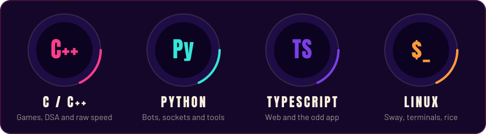

Screenshots are the game's own built-in showcase scenes (combat, boss). Sprites: Kenney, CC0.

 

Fan-made homage to the look of Grand Theft Auto VI. Not affiliated with Rockstar Games or Take-Two Interactive.

