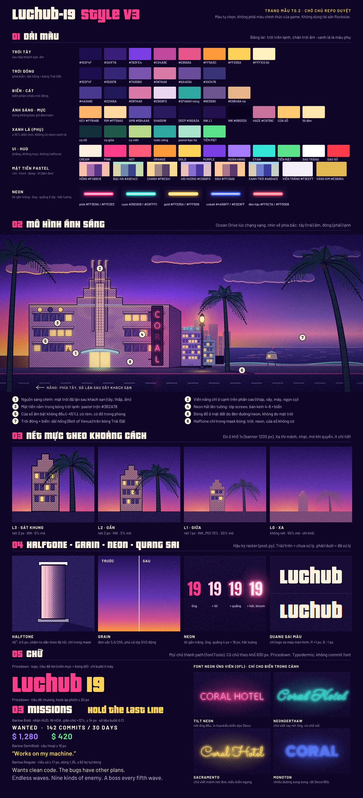

# STYLE v3 — Đặc tả hình ảnh (task T0.2)

Soạn 2026-11-27. **Trạng thái: ✅ chủ repo đã duyệt 2026-11-27** (toàn bộ mục 8, kể cả các phương án đề xuất). Đọc kèm `docs/PLAN-v3.md` (mục A, C) và `docs/REFERENCES.md`.
Mọi task vẽ ở Giai đoạn 1–3 phải theo file này. Muốn đổi luật thì sửa file này trước rồi mới sửa code.



Trang mẫu: `docs/style/style-sample.jpg`, sinh bằng `tools/style_sample.py`. Script này cũng là bản thử đầu tiên của pipeline v3
(SVG 3 lượt → Chrome 2x → hậu kỳ numpy/Pillow). Chạy lại:
```
python3 -m venv /tmp/v && /tmp/v/bin/pip install fonttools pillow numpy
/tmp/v/bin/python tools/style_sample.py   # → docs/style/style-sample.jpg (cần Pricedown ở tools/fonts/local/, xem 5.4)
```

## 0. Quyết định nền (chủ repo chốt 2026-11-27)
| Mục | Chốt |
|---|---|
| Bảng màu | **Lai: trên lạnh, dưới ấm.** Đỉnh trời chàm/tím, xuống hồng rồi cam ở chân trời. Phần được nắng chiếu thì ấm, bóng thì lạnh |
| Xanh lá | **Chỉ là màu phụ**: lá cọ, nước nông, pastel bạc hà, số tiền mặt trên HUD. **Không có neon xanh lá** |
| Hướng sáng | **Đúng thực tế**: Ocean Drive nhìn ra biển phía đông, nên mặt trời lặn **sau dãy khách sạn** (phía tây) |
| Font | **Pricedown** (font chữ ký của dòng GTA) cho logo và tiêu đề lớn, theo yêu cầu của chủ repo (27/11). Barlow cho chữ nội dung và HUD. **Tilt Neon** (OFL) cho biển hiệu trong cảnh (mục 5.3). Ràng buộc giấy phép: mục 5.4 |
| Đã chốt trước đó | Pastel + viền trắng + vài điểm vàng kim (REFERENCES M4); HUD: ngân hàng tím, tiền mặt xanh lá (M3); icon bằng chứng dưới sao (M2) |

Tất cả màu dưới đây do mình tự chọn, **không phải màu chính thức của game** (REFERENCES mục 4: chưa có mã màu nào xác minh được).

---

## 1. Dải màu

Trong code, các hằng số nằm ở đầu `tools/style_sample.py`. Khi làm T0.3 thì chuyển sang `tools/art/palette.py`, giữ nguyên tên.

### 1.1 Trời
| Dải | Từ đỉnh xuống chân trời (vị trí 0 → 1) | Dùng ở |
|---|---|---|
| `SKY_W` trời tây (ấm) | `#1E0F4F` 0 · `#3A1F7A` .28 · `#7B3FE4` .5 · `#C04A9E` .66 · `#E8558A` .79 · `#FF9A3C` .91 · `#FFD35A` 1 · lõi nắng `#FFF1C0` | Nửa trời phía sau dãy khách sạn |
| `SKY_E` trời đông (lạnh) | `#1E0F4F` 0 · `#352676` .4 · `#7A55B0` .68 · **`#D87AA8` .82 (dải hồng)** · `#6A4E9A` .92 · `#3A3478` 1 (bóng Trái Đất) | Nửa trời phía biển |

Trời đông có hai lớp màu ngoài đời thật: dải hồng ("Belt of Venus") nằm trên một dải xanh tối là bóng Trái Đất.
Mình đưa hai lớp này vào để nửa trời phía biển có màu riêng và không lặp lại trời tây.
Trong khung hình, `SKY_E` được phủ lên `SKY_W` bằng mask ngang, chuyển dần từ 48% tới 82% bề rộng.

### 1.2 Biển, cát
`SEA_FAR #4A3A8E` → `SEA_NEAR #221A5A` · vệt sáng `#D87AA8` · bọt sóng `#EBD8F0` · nước nông `TEAL #2FA8A0` (xanh lá phụ) ·
cát trong bóng `#6E5590` · rìa cát bắt sáng `#E8B48A`.
Biển chỉ phản chiếu trời đông (dải hồng, tím), **không phản chiếu mặt trời** vì mặt trời ở sau lưng người xem.

### 1.3 Ánh sáng và mực
| Tên | Hex | Vai trò |
|---|---|---|
| `KEY` | `#FFB46B` | Nắng (nguồn chính), quầng viền sáng |
| `RIM` | `#FFD9A0` | Nét viền sáng ở cạnh hứng nắng |
| `AMB` | `#5B4AA8` | Ánh trời lạnh (nguồn phụ), cũng là màu chiếu vào hốc |
| `SHADOW` | `#2A1A5E` | Bóng lạnh |
| `DEEP` | `#160A3A` | Bóng sâu, màu chấm halftone |
| `INK_MID` | `#24124F` | Nét lớp L1 |
| `INK` | `#0B0320` | Nét L2/L3. **Tối nhất cả trang**; không dùng `#000` |
| `HAZE` | `#C9739C` | Màu khí quyển để trộn vào lớp xa |
| `WINDOW` / lõi | `#FFC872` / `#FFE7B0` | Cửa sổ có đèn, đèn đường, sảnh |

### 1.4 Mặt tiền pastel: 4 tông
Mỗi màu pastel có 4 tông. Các tông được tính bằng **phép nhân màu** (màu vật × màu ánh sáng) để giữ sắc độ.
Lượt đầu dùng phép trộn với xám thì mọi pastel đều ra màu tím xám, mất hết bản sắc.

| Tông | Công thức | Khi nào |
|---|---|---|
| `rim` | trộn(trộn(nền, KEY, .5), trắng, .15) | Cạnh trên của phần cao hứng nắng |
| `front` | nền × `#A898DA` | Mặt tiền quay về người xem, nằm trong bóng trời |
| `deep` | nền × `AMB #5B4AA8` | Hốc, dưới mái hiên eyebrow, tường bên |
| `lit` | trộn(nền, WINDOW, .35) | Mặt nhận đèn ấm (sảnh, đèn đường) |

| Pastel | Nền | rim | front | deep | lit |
|---|---|---|---|---|---|
| Hồng | `#F4B6C8` | `#FBC0A9` | `#A16CAB` | `#573584` | `#F8BCAA` |
| Bạc hà | `#A9E4CC` | `#DAD4AB` | `#6F88AE` | `#3C4286` | `#C7DAAC` |
| Chanh | `#F6E3A1` | `#FBD498` | `#A2878A` | `#58426A` | `#F9DA91` |
| Oải hương | `#CDB8F0` | `#EAC1BA` | `#876ECD` | `#49359E` | `#DEBEC4` |
| Đào | `#FFC6A5` | `#FFC79A` | `#A8768D` | `#5B396D` | `#FFC793` |
| Xanh trời | `#A8D4EE` | `#DACDB8` | `#6F7ECB` | `#3C3E9D` | `#C6D0C3` |

Điểm nhấn: viền trắng `#F3EEF7` (trong bóng thì trộn 45% với `#3B2A78`), vàng kim `#E3B954` (chỉ dùng thành nét mảnh, mỗi toà nhà tối đa 1–2 chỗ).
Hai toà nhà cạnh nhau không được cùng màu pastel.

### 1.5 Neon
| Tên | Ống | Lõi | Ghi chú |
|---|---|---|---|
| pink | `#FF3E8A` | `#FFE3EE` | Biển chính |
| cyan | `#35E6D8` | `#E8FFFC` | Viền mái che, biển phụ |
| gold | `#FFD35A` | `#FFF6D6` | Hiếm, cho biển chữ viết |
| cobalt | `#4A6BFF` | `#E0E8FF` | Có cơ sở: biển Breakwater màu xanh cobalt (REFERENCES D10) |
| đèn hậu xe | `HOT #FF5C7A` | `#FFD0D8` | Chỉ cho xe |

Mỗi cảnh dùng **tối đa 2 màu neon chính** cộng 1 màu điểm. Không có neon xanh lá.

### 1.6 Xanh lá (màu phụ)
Cọ: tối `#14303A` · giữa `#1F5A4A` · viền `#B8D98A`. Nước nông `#2FA8A0`. Pastel bạc hà `#A9E4CC`. HUD tiền mặt `CASH #5BE38C`.
**Quy tắc:** xanh lá chiếm ≤ 10% diện tích mỗi cảnh. Cọ đứng ngược sáng nên gần như là bóng đen; xanh lá chỉ lộ ra ở viền sáng.

### 1.7 UI / HUD (lớp phẳng)
`CREAM #FFF1E0` · `PINK #FF3E8A` · `HOT #FF5C7A` · `ORANGE #FF9A3C` · `GOLD #FFD35A` · `PURPLE #7B3FE4` · ngân hàng `BANK #A57BFF` · `CYAN #35E6D8` ·
tiền mặt `CASH #5BE38C` · sao trắng `#FFFFFF` · sao đỏ `#FF3B4E`.
Các màu cũ trong `build_assets.py` (PINK, HOT, ORANGE, GOLD, PURPLE, CYAN, CREAM, INK) giữ nguyên giá trị. `BANK` sáng hơn PURPLE để đọc được trên nền tối.
Trạng thái sao (rỗng / trắng / trắng nhấp nháy / đỏ) theo REFERENCES W2 (mức thứ cấp).

### 1.8 Khí quyển
Màu lớp xa = trộn(màu gốc, `HAZE`, k) với k = **0.55** ở L0, **0.2** ở L1, **0** ở L2/L3. Lớp càng xa thì độ tương phản càng thấp và màu càng ngả về màu chân trời.

---

## 2. Mô hình ánh sáng

### 2.1 Nguồn sáng (banner và các cảnh ngoài phố)
Góc máy chuẩn: đứng trên vỉa hè Ocean Drive **nhìn về phía bắc**. Khách sạn ở bên trái (phía tây), bãi biển ở bên phải (phía đông).
Hệ quả: **nửa trái ấm, nửa phải lạnh**. Bố cục này vừa đúng địa lý vừa tạo được tương phản màu.

| # | Nguồn | Hướng / màu | Tác động |
|---|---|---|---|
| 1 | **Mặt trời (chính)** | Đã lặn sau dãy khách sạn, phía tây, thấp. `KEY` | Không chiếu xuống mặt đường. Chỉ chạm **cạnh trên của những gì cao**: bậc tháp, vây đứng, ngọn cọ, **mặt dưới của mây** (mây được chiếu từ dưới lên) |
| 2 | Trời (phụ) | Cả vòm trời, lạnh. Mặt tiền nhận màu `#A898DA`, hốc nhận `AMB` | Màu chung của mọi mặt tiền: pastel × ánh lạnh |
| 3 | Neon | Tại chỗ, hồng/cyan | Hắt lên tường (lớp screen, bán kính 4–6 × kích thước biển), vệt màu trên mặt đường |
| 4 | Cửa sổ, sảnh, đèn đường | Tại chỗ, ấm `WINDOW` | Tạo vũng sáng ấm trên vỉa hè và **bóng đổ trên mặt đất** |
| 5 | Đèn xe (T1.2) | Đèn pha trắng ấm, thấp, chiếu theo hướng chạy; đèn hậu `HOT` | Vệt sáng trên mặt đường |

### 2.2 Luật
1. **Bóng thì lạnh, sáng thì ấm.** Bóng không bao giờ đen hoặc xám trung tính. Điểm tối nhất là `INK #0B0320`.
2. **Bóng đổ phải khớp với nguồn gây ra nó.** Ở mặt đất, bóng đổ do đèn đường/neon/sảnh tạo ra, toả ra xa nguồn đèn, **không phải do mặt trời**.
   Ví dụ trong mẫu: bóng thân cọ toả ra xa cột đèn (chú thích 6).
3. **Viền sáng (rim) dày 1–1.6 px,** màu `RIM` + quầng `KEY` mờ. Chỉ đặt ở cạnh hướng lên hoặc hướng về phía tây của phần cao. Không có rim ở dưới 1/2 chiều cao toà nhà.
4. **Hốc tối** (dưới mái hiên, trong ô cửa, tường bên) dùng tông `deep`. Mái hiên eyebrow luôn có một dải `deep` ngay dưới nó.
5. **Cửa sổ:** khoảng 40–50% có đèn, bật **không đều** (dùng nhiễu có seed, không xếp ô bàn cờ). Ô có đèn có rèm lá sách,
   vài ô có đồ trong phòng (cây cảnh). Ô không đèn phản chiếu trời đông (`#3C2F7E` + vệt chéo `#8E6AB8` 25%).
6. **Thang độ sáng (3 mức):** trời và neon sáng nhất → mặt tiền ở mức trung tối → tiền cảnh (cọ sát khung) tối nhất.
   Mặt tiền không sáng hơn 70% độ sáng của trời phía sau.
7. Cảnh trong nhà (bàn làm việc, hồ sơ, vòng vũ khí, radio) vẫn giữ cặp **ấm chính + lạnh phụ** (xem mục 6). Bóng vẫn lạnh.

---

## 3. Nét mực theo khoảng cách

| Lớp | Ví dụ | Nét viền (banner 1200) | Nét viền (áp phích 830) | Màu nét | Mờ khí quyển | Halftone (mask) | Chi tiết |
|---|---|---|---|---|---|---|---|
| **L3 sát khung** | Cọ ở mép khung, đồ vật tiền cảnh | 3 px | 2.2 px | `INK` 100% | 0 | 0.8 | Đầy đủ, có vết bẩn/cũ |
| **L2 gần** | Khách sạn chính, xe, cột đèn | 2 px | 1.5 px | `INK` 100% | 0 | 0.7 | Đầy đủ |
| **L1 giữa** | Khách sạn xa hơn, chòi cứu hộ | 1 px | 0.8 px | `INK_MID` 70% | 20% | 0.4 | Khối chính + cửa sổ, không có nét bên trong |
| **L0 xa** | Dãy tháp cuối đường, mây | 0 | 0 | — | 55% | 0 | Chỉ có khối và vài chấm cửa sổ |

Quy tắc nét:
- Nét bên trong (khung cửa sổ, đường chia) mảnh bằng **0.4–0.6 ×** nét viền ngoài của cùng lớp.
- **Vật mảnh không có viền** (lá chét cọ, dây điện, rèm): bản thân nét đã là hình. Chỉ có sống lá được tô đậm ở L2/L3.
- Đầu nét bo tròn, góc nối tròn. Dùng nét viền đều (SVG stroke) ở T0.x. Nét có độ dày thay đổi (thon hai đầu) là việc của T0.4, khi làm viền mực bằng raster.
- Mỗi cảnh phải có đủ **≥ 3 lớp**. Trong mẫu, cảnh Ocean Drive có cả 4: L0 dãy tháp, L1 khách sạn giữa + chòi cứu hộ, L2 khách sạn CORAL + cột đèn + cọ vỉa hè, L3 hai cây cọ ở mép.

---

## 4. Halftone và hậu kỳ

### 4.1 Ba lượt render
Mỗi hình được vẽ **3 lần với cùng hình học** (class `Scene` trong `style_sample.py`):
1. `col`: màu thật.
2. `sh`: **mask bóng** (xám 0..1). Quyết định chỗ có halftone. Vật đứng trước che vật đứng sau, nên mask luôn đúng thứ tự lớp.
3. `em`: **mask phát sáng**. Chỉ neon, cửa sổ, đèn và quầng mặt trời mới được bloom; chữ cream và ô màu không bị loé.

### 4.2 Thứ tự hậu kỳ (render ở 2x)
| Bước | Thông số trong mẫu | Ghi chú |
|---|---|---|
| 1. Bloom | (col × em) làm mờ 8 px × 0.55 + 32 px × 0.4 (ở 2x), cộng bằng screen | Chỉ từ mask `em` |
| 2. **Halftone** | Lưới xoay 45°, **ô 10 px ở 2x = 5 px ở 1x** (khổ 1200, hiển thị khoảng 3.5 px); bán kính chấm = ô × .5 × √(mask × (.35 + .65 × độ tối)); chấm tối 34% về `DEEP` | **Chỉ trong mask bóng.** Không có ở trời, biển, neon, cửa sổ, chữ, UI. Mask được làm mờ 3 px để mép mềm |
| 3. Thu về 1x | LANCZOS | Đề xuất xuất ở 1.5x cho màn retina. Kích thước cuối chốt ở T0.4 theo ngân sách |
| 4. Quang sai màu | R dịch +1 px, B dịch −1 px | **Chỉ dùng cho logo và mép màn hình** (CRT vibeKing, LCD radio). Không dùng cho chữ thường |
| 5. Chỉnh màu | Bóng kéo về `#1E0F4F` (×(1−L)³ × .18), vùng sáng ngả `#FFE2B8` (×L⁴ × .10) | Chỉ áp lên vùng tranh, không áp lên ô màu mẫu |
| 6. Vignette | Tối dần về `INK`, mạnh nhất 32% ở góc | Từng cảnh |
| 7. **Grain** | Nhiễu đơn sắc, độ lệch chuẩn 5.5/255, ở 1x | Phần nền raster được nướng grain sẵn. Lớp SVG động phủ thêm một tile PNG grain 128 px, độ mờ khoảng .06, để vật chuyển động không bị "sạch" hơn nền |

**Thứ tự lớp trong SVG cuối:** nền raster (đã có grain) → vật động vector (xe, neon, cọ, mây) → tile grain → **UI/chữ (sắc nét, không grain, không halftone, không nét mực)**.

### 4.3 Bất toàn có chủ đích (khoảng 5%)
Có trong mẫu: một chữ neon chập chờn (`R` trong CORAL, `C` trong BEACH), sơn bạc thành từng mảng (elip mờ 10%), vệt bẩn chảy dưới mái hiên, cửa sổ bật đèn không đều.
Thêm khi vẽ thật: một đoạn ống neon tắt hẳn, một ô gạch kính tối, vết nứt nhỏ trên vỉa hè, nhãn dán bong mép (đồ vật trên bàn).
Mỗi cảnh ghi lại danh sách bất toàn của nó trong docstring.

---

## 5. Typography

### 5.1 Font
| Font | Giấy phép | Vai trò |
|---|---|---|
| **Pricedown Bl** (Typodermic) | Typodermic Desktop EULA v260817 (miễn phí, dùng thương mại được, có giới hạn; xem 5.4) | **Logo, tiêu đề chương, tên mission, hook áp phích, chữ lớn.** Rockstar xác nhận vẫn dùng Pricedown cho GTA VI (REFERENCES H1, mức xác minh) |
| **Barlow** Regular / SemiBold / Bold | OFL (đã có) | Tiểu sử, câu thoại, nhãn HUD, **mọi chữ và số được build trong GitHub Actions** |
| **Anton** | OFL (đã có) | Dự phòng khi máy không có Pricedown; chữ lớn trong HUD (vì HUD build ở CI) |
| **Tilt Neon** (`tools/fonts/TiltNeon-Variable.ttf`, trục mặc định) | OFL | **Chỉ dùng cho biển hiệu trong cảnh.** Không dùng cho UI hay chữ nội dung |

Kiểu chữ Pricedown đậm chất GTA: tô màu (`CREAM`, `PINK`, `GOLD`) + **viền mực `INK` dày** (6 px ở cỡ 78, 3 px ở cỡ 34–38) nằm dưới phần tô + **bóng đổ lệch 4–5 px** màu `INK` cho chữ lớn.
Hàm mẫu: `gta_title()` trong `style_sample.py`.
**Vẫn cấm:** chép hình logo GTA VI (chữ số VI, khối màu của logo). Logo `LUCHUB / 19` dựng từ nét Pricedown rồi cắt, xếp tầng thành hình riêng (T2.2).
EULA mục 4.2 cho phép sửa hình chữ sau khi chữ đã thành path.
Mọi chữ đều được chuyển thành path bằng fontTools. Pricedown, Anton và Barlow đều đủ dấu tiếng Việt. Barlow **không có** `σ`, `→`, `←`; mũi tên phải vẽ bằng path.

### 5.2 Cỡ chữ (theo khổ 830 của áp phích; banner 1200 thì nhân 1.45)
| Vai trò | Font | Cỡ tối thiểu | Ghi chú |
|---|---|---|---|
| Logo | Pricedown | — | Viền mực + bóng đổ, xếp tầng (T2.2) |
| Tiêu đề chương | Pricedown | 34 px | Số chương `PINK`, chữ `CREAM`, viền 3 px |
| Hook áp phích | Pricedown | 30 px | `GOLD` hoặc `CREAM`, viền 3 px. Đọc được trên mobile (khoảng 14 px) |
| Nhãn HUD / tag | Barlow Bold, IN HOA | 14 px | Giãn chữ +12%, chữ ngắn và thực dụng |
| Câu thoại | Barlow SemiBold | 16 px | Ngoặc kép cong “ ”, màu `GOLD` |
| Tiểu sử | Barlow Regular | 17 px | Dòng cao 1.35, ≤ 62 ký tự/dòng. Trên mobile còn khoảng 8 px, chấp nhận được vì alt text có đủ nội dung |

### 5.3 Font neon — đã chọn Tilt Neon (bảng ứng viên giữ lại để tham khảo)
| Font | Kiểu | Nhận xét |
|---|---|---|
| **Tilt Neon** (đề xuất) | Chữ không chân, nét ống đều, IN HOA đẹp | Hợp với biển dọc kiểu Deco (khối chữ hoa xếp dọc). Đây là mình **quan sát ảnh Ocean Drive, chưa có nguồn trong REFERENCES**. Đọc rõ ở cỡ nhỏ |
| Neonderthaw | Chữ viết tay nét ống, có chỗ nối như ống uốn thật | Giàu chất "Vice" nhất nhưng khó đọc ở cỡ nhỏ; chỉ hợp cho 1 biển ngang lớn |
| Sacramento | Chữ viết mảnh nét đơn | Thanh lịch, dễ bị mảnh quá khi thu nhỏ |
| Monoton | Nhiều đường song song | Rất Deco/80s nhưng không phải nét ống đơn, trông giống logo hơn là neon |

Đã chép `TiltNeon-Variable.ttf` + `OFL-TiltNeon.txt` vào `tools/fonts/` (nguồn: `github.com/google/fonts`, `ofl/tiltneon/`). Ảnh mẫu đã duyệt được render với cả 4 ứng viên; muốn render lại y hệt thì tải 4 font vào một thư mục rồi chạy `style_sample.py --neon <thư mục>`.

### 5.4 Ràng buộc giấy phép Pricedown (đọc từ EULA đi kèm file tải về)
Nguồn: DaFont (`dl.dafont.com/dl/?f=pricedown`). EULA ghi DaFont là nơi phân phối được Typodermic cho phép.
Bản tải về gồm `Pricedown Bl.otf` + `Typodermic Desktop EULA 2026.pdf` (v260817), tải ngày 2026-11-27. Phần "phi thương mại" không phải là điều kiện quyết định:
EULA cho dùng cả thương mại. Điều kiện quyết định là **không được phát tán file font**.

| Điều | EULA | Cách làm trong repo |
|---|---|---|
| 2.2 | Được dùng để làm ảnh tĩnh, logo, ảnh phát hành công khai, miễn là sản phẩm **không chứa file font** và chữ là **hình cố định**, không phải từng glyph để phần mềm ghép lại | Mỗi chuỗi chữ thành **một path** trong SVG (đúng cách `Face.path()` đang làm). Không bao giờ nhúng font hay `@font-face` |
| 4.1, 4.6 | Không được upload, chia sẻ, phát tán file font, kể cả trong phần mềm công khai | Font nằm ở `tools/fonts/local/` (đã thêm vào `.gitignore`). **Không commit** |
| 4.3, 4.4 | Không dùng trong bộ sinh ảnh tự động, không đặt trên server | **GitHub Actions không được dùng Pricedown.** Chỉ asset build ở máy chủ repo mới dùng Pricedown. Asset do Actions build lại hằng ngày (`hud.svg`) dùng Barlow/Anton |
| 4.5 | Không làm bộ glyph rời để ghép chữ mới | Không lưu bảng path từng chữ số/chữ cái để Actions ghép. Số liệu động luôn dùng Barlow/Anton |
| 4.7 | Không dùng glyph hay hình render của font để huấn luyện AI | Không dùng vào việc đó. Claude xem ảnh preview để duyệt là cách dùng thông thường |
| 3.3 | Lưu lại nguồn và phiên bản font | Chính là bảng này + file EULA nằm cạnh font trong `tools/fonts/local/` |

Máy khác (hoặc session mới) không có font: `build_assets.py` phải tự dùng Anton thay và in cảnh báo (làm ở T0.3).
Tải lại font từ DaFont vào `tools/fonts/local/` là đủ.

---

## 6. Bố cục từng mục

Luật chung (PLAN mục C): **không có hai mục nào dùng chung khung, góc máy hay nguồn sáng chính.** Mỗi mục là một cảnh khác nhau.

| Mục | Cảnh / khung | Góc máy | Sáng chính → phụ | Xa / giữa / gần | Tiêu điểm | Vùng chữ | Hoạt ảnh | Khổ · ngân sách |
|---|---|---|---|---|---|---|---|---|
| **Banner** | Ocean Drive chạng vạng | Ngang tầm mắt trên vỉa hè, nhìn về phía bắc, phối cảnh 1 điểm, điểm tụ ở khoảng 55–60% chiều ngang | Nắng lặn sau khách sạn (viền) → trời lạnh, neon, cửa sổ | Tháp cuối đường, mây / dãy khách sạn, chòi cứu hộ, biển / khách sạn chính, xe 80s, cột đèn / cọ sát mép | Logo xếp tầng + xe | Logo ở vùng trời; 3 tagline đã duyệt ở dải dưới | Xe chạy sang phải đúng hướng, neon nhấp nháy, cọ đung đưa lệch pha, mây trôi, cửa sổ bật đèn, tagline tự gõ | 1200 × 440–520 · ≤ 1 MB |
| **Dải tiêu đề chương** | Mỗi chương là một vật thật trên phố. Đề xuất: 01 biển tên đường, 02 bảng neon, 03 biển quảng cáo, 04 tấm vé, 05 mặt đài | Chụp thẳng, cận | Mỗi vật tự chiếu sáng hoặc nhận đèn đường | 1–2 lớp (vật + nền mờ) | Số + tên chương | Trên chính vật | Một chi tiết nhỏ mỗi dải | 830 × 104 · ≤ 60 KB mỗi dải |
| **Player One** (bàn làm việc; PLAN gọi là Safehouse, khác chương rice đang chờ) | Bàn cạnh cửa sổ nhìn ra Ocean Drive | Ngang mặt bàn, hơi chếch, cửa sổ ở hậu cảnh | Đèn bàn ấm (trái) → ánh chạng vạng qua cửa sổ + **sọc neon hồng/cyan qua rèm lá sách** + màn hình laptop | Phố ngoài cửa (lấy từ thư viện, mờ 55%) / khung cửa, rèm / laptop, cà phê, tai nghe, điện thoại | Màn hình terminal (lệnh thật của repo công khai) | Hook, tiểu sử, thoại đã duyệt; thẻ tin nhắn nổi | Con trỏ terminal, sọc neon nhấp nháy, thẻ tin nhắn trượt vào | 830 × 420 · ~400 KB |
| **HUD** | Cảnh phố từ thư viện (góc khác banner: nhìn từ sau đuôi xe hoặc góc cao) | Góc thứ ba | Cùng giờ chạng vạng | Theo banner | Sao truy nã | **Bám REFERENCES:** thanh chỉ số góc trên trái (H5), sao + icon bằng chứng + 2 số tiền góc trên phải (H7, W3, M3), minimap góc dưới trái (H10; hình dạng tự chọn và ghi rõ là tự chọn) | Sao nhấp nháy theo trạng thái W2 | 830 × 340 · ~350 KB |
| **Mission vibeKing** | **Tủ máy arcade** minh họa bao quanh ảnh chụp thật | Chính diện, hơi ngước lên | Ánh CRT lạnh từ màn hình → đèn marquee ấm | Phòng game mờ / tủ máy / tay cầm, đồng xu | Màn hình | Hook, tiểu sử, thoại đã duyệt trên marquee/bảng bên | Scanline, quang sai ở mép CRT | 830 × 420 · ~450 KB |
| **Mission didau** | Đề xuất: **bản đồ du lịch gấp / bưu thiếp** có ghim địa điểm và ảnh chụp app thật (hỏi chủ repo ở T3.4) | Nhìn từ trên xuống | Nắng ấm cuối ngày chiếu xiên | Mặt bàn / bản đồ / ảnh chụp, ghim | Ảnh app | Chữ do chủ repo duyệt | Ghim rơi xuống, đường đi tự vẽ | 830 × 420 · ~400 KB |
| **Mission Classified** | Bìa hồ sơ trên bàn | Nhìn từ trên xuống, xoay nhẹ | **Đèn bàn đổ thẳng xuống, bóng cứng** (khác didau) | Bàn / bìa giấy / kẹp giấy, con dấu, ảnh bị che | Con dấu | Chữ đã duyệt | Dấu đóng xuống một lần | 830 × 420 · ~300 KB |
| **Loadout** | Vòng chọn vũ khí phủ lên cảnh phố bị làm mờ (REFERENCES M-a; cảnh bị làm mờ khớp với M-c) | Phẳng, ở giữa | Ô đang chọn tự phát sáng | Phố mờ / vòng / 4 đồ vật minh họa | Ô đang chọn | "SELECT YOUR WEAPON" + 4 chú thích đã duyệt, tab `WEAPONS / ITEMS` | Ô sáng lần lượt | 830 × 352 · ~300 KB |
| **Radio** | Bộ dàn trong xe 80s, nhìn qua kính chắn gió | Từ ghế lái | Ánh LCD + đèn bảng đồng hồ → đèn phố bokeh qua kính | Phố bokeh / táp lô / mặt đài | Màn LCD chạy chữ | Tên đài + 3 bài (`data/radio.json`) | LCD chạy chữ, kim dò đài | 830 × 350 · ~250 KB |
| **Chân trang** | Danh đề cuối phim | Phẳng | Không có | — | Rắn contribution | Dòng fan-made | Chữ cuộn | nhỏ |

Tổng ước tính khoảng 4 MB, nằm trong ngân sách 3–5 MB của PLAN.

---

## 7. Checklist trước mỗi mốc 🔶 (mở rộng từ PLAN mục C)
Mỗi asset ghi kết quả checklist trong mô tả commit hoặc ghi chú duyệt.

**Bố cục**
- [ ] Không dùng chung khung, góc máy hay nguồn sáng chính với mục khác (so với bảng mục 6).
- [ ] Có ≥ 3 lớp chiều sâu, và gọi được tên vật ở từng lớp.
- [ ] Khung đầu (t = 0) đã đẹp như ảnh tĩnh.

**Ánh sáng và màu**
- [ ] Gọi tên được nguồn sáng chính và hướng của nó. Rim, bóng đổ và vũng sáng đều khớp nguồn.
- [ ] Bóng lạnh, không có `#000` hay xám trung tính. Điểm tối nhất là `INK`.
- [ ] Tông pastel được tính bằng phép nhân (mục 1.4). Hai toà nhà cạnh nhau khác màu.
- [ ] Neon ≤ 2 màu chính + 1 màu điểm. Không có neon xanh lá. Xanh lá ≤ 10% diện tích.

**Nét và texture**
- [ ] Nét theo bảng mục 3. Lớp xa không có nét.
- [ ] Halftone chỉ có trong mask bóng. Bloom chỉ từ mask phát sáng.
- [ ] Quang sai chỉ ở logo hoặc mép màn hình. UI và chữ sắc nét, không grain.
- [ ] Liệt kê ≥ 3 điểm bất toàn có chủ đích.

**Nội dung**
- [ ] Mỗi đồ vật có lý do tồn tại (ghi ra). Không có chi tiết độn.
- [ ] Chữ đã duyệt (HANDOFF mục 6) giữ nguyên văn.
- [ ] Mỗi khẳng định về GTA VI có mã nguồn trong REFERENCES kèm độ tin cậy. Không dùng tài sản Rockstar (logo, Pricedown, tên app, nhân vật, ảnh).
- [ ] Không nhắc hay link repo riêng tư.

**Kỹ thuật**
- [ ] Nằm trong ngân sách dung lượng (mục 6).
- [ ] Xem ở khổ 390 px (mobile) và trên nền trang sáng `#ffffff`.
- [ ] Chạy lại được từ script, không sửa tay file trong `assets/`.

---

## 8. Mốc 🔶 T0.2 — đã duyệt 2026-11-27
Chủ repo trả lời "duyệt ổn" cho cả 7 câu dưới đây. Mọi câu theo phương án đề xuất hoặc theo giá trị hiện có trên trang mẫu.
1. Bảng màu nhìn trên trang mẫu có đúng ý không (đặc biệt là tông pastel trong bóng: hồng ra `#A16CAB`, có bị tím quá không)?
2. Mật độ halftone (ô 5 px, đậm 34%): giữ, nhẹ hơn hay mạnh hơn?
3. Nét mực 3/2/1/0 px: giữ hay đổi?
4. Chọn font neon: **Tilt Neon** (đề xuất), Neonderthaw, Sacramento hay Monoton.
4b. Kiểu Pricedown (viền mực dày + bóng đổ) trên tiêu đề và logo mẫu đã đủ chất GTA chưa?
5. Góc máy chuẩn "nhìn về phía bắc, khách sạn bên trái, biển bên phải" cho banner: đồng ý không? (T2.1 sẽ vẽ 3 phác thảo dựa trên góc này)
6. Đề xuất vật cho các dải tiêu đề chương và khung cho mission didau (mục 6) có ổn không?
